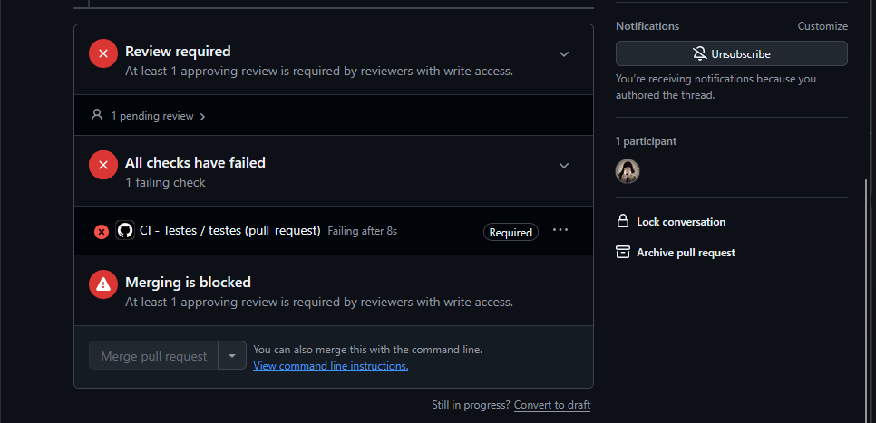
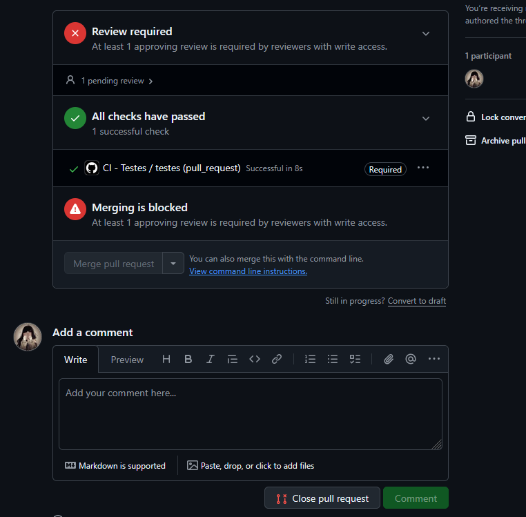
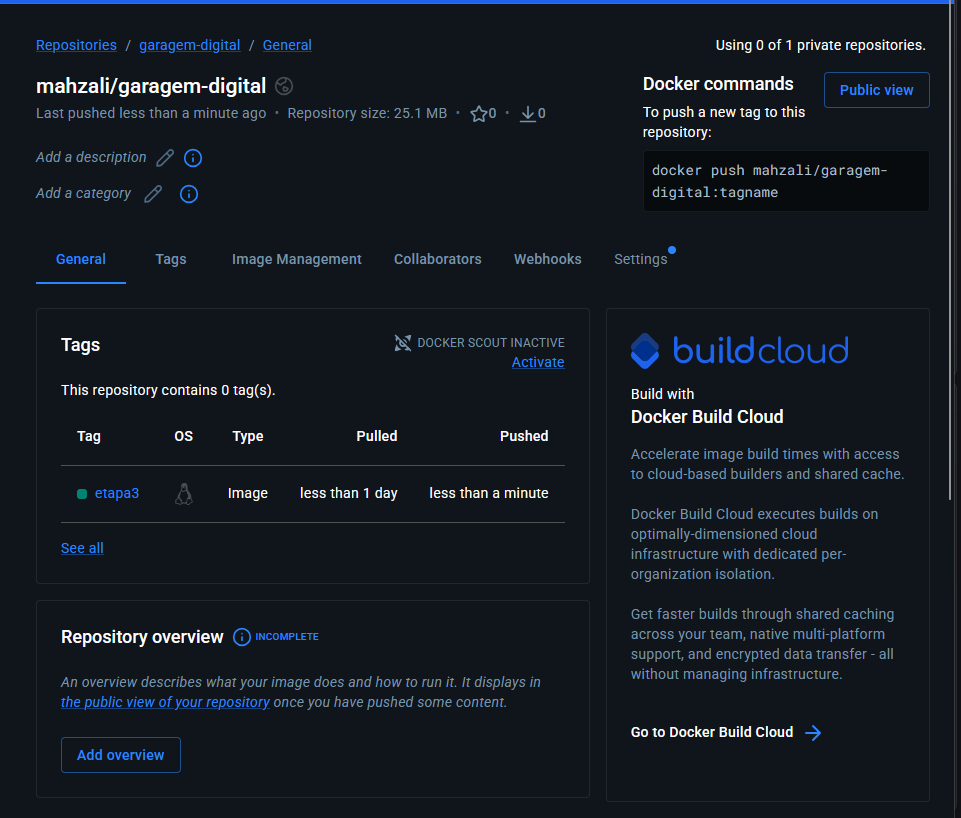

# Garagem Digital


## Equipe — Etapa 03

Disciplina: Bootcamp II  
Instituição: CEUB

| Integrante | Matrícula | GitHub | Responsabilidade | Principal PR |
|---|---|---|---|---|
| Mariana Oliveira Mazali | 22552647 | [@Mah-zali](https://github.com/Mah-zali) | Filtro de modelos, testes e GitHub Actions | [PR #1](https://github.com/brureads/bootcamp2-projeto-final/pull/1) |
| Bruna Martins Moura | 22650015 | [@brureads](https://github.com/brureads) | Ordenação de veículos e resolução de conflitos | [PR #2](https://github.com/brureads/bootcamp2-projeto-final/pull/2) |
| Damylle Souza Oliveira | 22553445 | [@damyllee](https://github.com/damyllee) | Pesquisa de favoritos por marca e modelo | [PR #3](https://github.com/brureads/bootcamp2-projeto-final/pull/3) |


Cada integrante será responsável por desenvolver código
em uma branch própria, abrir uma Pull Request e
participar da revisão de código de outra integrante.

Testes automatizados, CI, Docker e documentação serão
responsabilidades compartilhadas pelo grupo.

## 1. Descrição do projeto

A Garagem Digital é uma aplicação web desenvolvida para explorar marcas e modelos de carros disponíveis no mercado brasileiro.

O sistema utiliza APIs públicas para apresentar informações sobre veículos, incluindo modelos, versões, códigos de referência, valores da Tabela FIPE e imagens ilustrativas.

Na Etapa 02 do Bootcamp II, o projeto evoluiu com a implementação de persistência de dados utilizando Firebase Firestore e conteinerização utilizando Docker e Nginx.

A aplicação permite que o usuário organize seus veículos favoritos, mantendo os registros armazenados em um banco de dados na nuvem.

## 2. Funcionalidades

- Seleção de marcas de veículos.
- Consulta de modelos pela BrasilAPI.
- Exibição das versões disponíveis.
- Consulta de valores da Tabela FIPE.
- Exibição de códigos de referência.
- Busca de imagens pelo Wikimedia Commons.
- Adição de veículos aos favoritos.
- Listagem dos veículos favoritos.
- Exclusão de veículos favoritos.
- Persistência de dados com Firebase Firestore.
- Autenticação anônima com Firebase Authentication.
- Interface responsiva.
- Execução da aplicação em containers Docker.
- Filtro de modelos por nome, ignorando acentos e diferenças entre maiúsculas e minúsculas.
- Ordenação de modelos por nome ou quantidade de versões FIPE.
- Pesquisa de veículos favoritos por marca e modelo.

## 3. Tecnologias utilizadas

- HTML5
- CSS3
- JavaScript
- Fetch API
- BrasilAPI
- API FIPE Parallelum
- Wikimedia Commons API
- Firebase Firestore
- Firebase Authentication
- Docker
- Nginx
- Git e GitHub
- GitHub Pages

## 4. APIs utilizadas

### BrasilAPI

Responsável pela consulta das marcas e dos modelos de veículos.

Documentação:

https://brasilapi.com.br/docs

Endpoint de marcas:

https://brasilapi.com.br/api/fipe/marcas/v1/carros

Endpoint de modelos:

https://brasilapi.com.br/api/fipe/veiculos/v1/carros/{codigoMarca}

### API FIPE Parallelum

Utilizada para consultar anos e valores de referência dos veículos.

https://fipe.parallelum.com.br/

### Wikimedia Commons

Utilizada para buscar imagens ilustrativas dos modelos.

https://commons.wikimedia.org/

## 5. Persistência de dados — Firebase

Na segunda etapa do projeto, foi implementada a persistência dos veículos favoritos utilizando Firebase Firestore.

O Firestore é um banco de dados NoSQL em nuvem que permite armazenar documentos organizados em coleções.

Foi escolhido por permitir integração direta com JavaScript, sem a necessidade de desenvolver um backend próprio.

### Estrutura do banco de dados

Os dados são organizados da seguinte forma:

usuarios/
  {userId}/
    favoritos/
      {favoritoId}/
        marca
        modelo
        criadoEm

Cada favorito contém:

- marca: fabricante do veículo.
- modelo: nome do veículo selecionado.
- criadoEm: data e horário de criação do registro.

### Operações implementadas

**CREATE:** adiciona um veículo à lista de favoritos.

**READ:** consulta os veículos favoritos armazenados no Firestore.

**DELETE:** remove um veículo da lista de favoritos.

Essas operações atendem ao requisito mínimo de persistência da Etapa 02.

### Teste de persistência

Foi realizado um teste salvando um veículo BYD Dolphin Mini nos favoritos.

Após fechar e reabrir a aplicação no mesmo navegador, o veículo permaneceu salvo.

Esse comportamento demonstra que os dados são armazenados no Firebase Firestore, e não apenas em variáveis temporárias da aplicação.

A interface também disponibiliza a operação de remoção dos registros.

### Autenticação e segurança

A aplicação utiliza Firebase Authentication com autenticação anônima.

Cada visitante autenticado recebe um identificador utilizado para organizar os documentos no banco de dados.

As regras de segurança do Firestore restringem o acesso à coleção de favoritos ao próprio usuário autenticado.

O arquivo firestore.rules contém essas regras.

### Limitações conhecidas

Como a autenticação é anônima, os favoritos não são automaticamente compartilhados entre diferentes dispositivos ou navegadores.

Caso o usuário apague os dados de autenticação do navegador, poderá perder o acesso aos favoritos armazenados anteriormente.

## 6. Conteinerização com Docker

A aplicação foi conteinerizada utilizando Docker e a imagem base nginx:alpine.

O Nginx funciona como servidor web responsável por disponibilizar os arquivos estáticos da aplicação.

A utilização do Docker permite executar o projeto em um ambiente padronizado, reduzindo diferenças de configuração entre máquinas.

### Dockerfile

O Dockerfile utiliza a imagem nginx:alpine e copia os arquivos HTML, CSS e JavaScript para o diretório servido pelo Nginx.

Na versão 1.1, foi adicionada uma configuração personalizada para o servidor por meio do arquivo nginx.conf.

### Construção da imagem

docker build -t bootcamp2-app:1.1 .

### Execução com Docker

Para executar a versão 1.1 publicada no Docker Hub:

docker run -d -p 8080:80 --name garagem-digital brureads/bootcamp2-app:1.1

Após iniciar o container, a aplicação fica disponível em:

http://localhost:8080

O comando pode ser executado em uma máquina com Docker instalado e acesso à internet para baixar a imagem.

### Repositório Docker Hub

https://hub.docker.com/r/brureads/bootcamp2-app

## 7. Sidequest 1 — .dockerignore

Foi criado o arquivo .dockerignore para evitar que arquivos desnecessários sejam enviados ao contexto de construção da imagem Docker.

Entre os arquivos que podem ser excluídos estão:

- Diretório .git
- Arquivos temporários
- Documentação desnecessária ao build
- Arquivos específicos do ambiente de desenvolvimento

O uso do .dockerignore reduz o tamanho do contexto enviado ao Docker, podendo diminuir o tempo de construção da imagem.

O arquivo está disponível no repositório GitHub.

## 8. Sidequest 2 — Versionamento de imagens

Foram publicadas três tags no Docker Hub:

### Versão 1.0

Primeira versão funcional da Garagem Digital, utilizando Nginx para servir os arquivos da aplicação.

Imagem:

brureads/bootcamp2-app:1.0

### Versão 1.1

Versão com melhoria técnica na configuração do Nginx.

Foi criado o arquivo nginx.conf, contendo os cabeçalhos HTTP:

- X-Content-Type-Options: nosniff
- Referrer-Policy: strict-origin-when-cross-origin

Esses cabeçalhos ajudam a reforçar a segurança da aplicação.

A alteração não modifica a aparência nem as funcionalidades do site.

Imagem:

brureads/bootcamp2-app:1.1

### Versão latest

Representa a versão mais recente da aplicação.

A tag latest aponta para a mesma imagem da versão 1.1.

Imagem:

brureads/bootcamp2-app:latest

### Evidência

As três tags estão disponíveis publicamente em:

https://hub.docker.com/r/brureads/bootcamp2-app/tags

## 9. Sidequest 3 — Descrição no Docker Hub

O repositório público no Docker Hub possui uma descrição do projeto e uma visão geral com:

- Apresentação da aplicação.
- Principais funcionalidades.
- Tecnologias utilizadas.
- Comando docker run.
- Link do repositório GitHub.

Repositório:

https://hub.docker.com/r/brureads/bootcamp2-app

## 10. Sidequest 4 — Dois containers simultâneos

Foram executados dois containers da aplicação simultaneamente, utilizando a imagem Docker da versão 1.0.

### Primeiro container

docker run -d -p 8080:80 --name garagem-digital-v1 bootcamp2-app:1.0

### Segundo container

docker run -d -p 8081:80 --name garagem-digital-v2 bootcamp2-app:1.0

### Verificação

docker ps

O comando apresentou os dois containers em execução simultânea.

O primeiro ficou disponível na porta 8080 e o segundo na porta 8081.

### Evidência dos containers


A imagem foi registrada como evidência da execução simultânea dos containers.

## 11. Kubernetes e orquestração

Caso fosse necessário gerenciar 100 containers, executar comandos Docker individualmente seria uma solução pouco eficiente.

Uma alternativa seria utilizar o Kubernetes, uma plataforma de orquestração de aplicações conteinerizadas.

O Kubernetes permite automatizar a implantação, o gerenciamento, a recuperação e o dimensionamento de containers.

### Cluster

Um cluster é um conjunto de máquinas utilizadas para executar as aplicações.

Essas máquinas disponibilizam os recursos necessários para os containers.

### Pod

Um pod é a menor unidade de execução gerenciada pelo Kubernetes.

Ele pode conter um ou mais containers que compartilham recursos de rede e armazenamento.

### Réplicas

As réplicas permitem manter várias instâncias de uma aplicação em funcionamento.

Se uma instância apresentar problemas, o Kubernetes pode criar uma substituta para manter a quantidade desejada de réplicas.

### Gerenciamento de 100 containers

Para administrar 100 containers, seria possível utilizar recursos como Deployments para definir a quantidade desejada de réplicas.

O Kubernetes distribuiria os pods entre os nós disponíveis do cluster e acompanharia seu funcionamento.

Também seria possível utilizar Services para facilitar o acesso e distribuir o tráfego entre as instâncias.

Dessa forma, a orquestração permitiria gerenciar aplicações em maior escala, aumentando a disponibilidade e facilitando a manutenção.

## 12. Como executar localmente

Clone o repositório:

git clone https://github.com/brureads/bootcamp2-projeto-final.git

Entre na pasta do projeto.

Para executar sem Docker, utilize um servidor HTTP local, como o Live Server do Visual Studio Code.

Também é possível utilizar Python:

python -m http.server 5500

Depois acesse:

http://localhost:5500

Para executar com Docker, utilize a imagem publicada no Docker Hub.

A funcionalidade de favoritos depende do Firebase Authentication e Firestore configurados corretamente.

## 13. Versionamento com Git

O projeto foi desenvolvido no mesmo repositório utilizado na Etapa 01.

Durante a Etapa 02, foram realizados commits para registrar a evolução da aplicação, incluindo:

- Integração com Firebase e favoritos.
- Criação do Dockerfile e .dockerignore.
- Registro das evidências dos containers.
- Documentação do Firebase, Docker e Kubernetes.
- Configuração de segurança do Nginx.
- Atualização da documentação final.

O histórico de commits está disponível no GitHub.

## 14. Links do projeto

### Repositório GitHub

https://github.com/brureads/bootcamp2-projeto-final

### Aplicação GitHub Pages

https://brureads.github.io/garagem-digital/

### Repositório Docker Hub

https://hub.docker.com/r/brureads/bootcamp2-app

### Tags Docker

https://hub.docker.com/r/brureads/bootcamp2-app/tags

### Comando para avaliação

docker run -d -p 8080:80 --name garagem-digital brureads/bootcamp2-app:1.1

## 15. Conclusão

A Etapa 02 do Bootcamp II permitiu evoluir a Garagem Digital com recursos de persistência de dados e conteinerização.

A integração com Firebase Firestore possibilitou armazenar os veículos favoritos em um banco de dados real.

A utilização do Docker e do Nginx permitiu disponibilizar a aplicação em um ambiente padronizado.

Foram utilizadas diferentes tags de imagens Docker, além da execução simultânea de containers em portas distintas.

O projeto também proporcionou experiência prática com versionamento Git, Docker Hub, documentação técnica e conceitos de Kubernetes.

A aplicação mantém sua proposta original de oferecer uma interface simples, responsiva e organizada para explorar veículos.

# Etapa 03 — Desenvolvimento Colaborativo

## 16. Objetivo da etapa

A Etapa 03 teve como objetivo implementar um fluxo profissional
de desenvolvimento colaborativo, com branches individuais,
Pull Requests, revisão de código, testes automatizados,
integração contínua e publicação no Docker Hub.

O projeto Garagem Digital foi aprimorado pelas integrantes
Mariana Oliveira Mazali, Bruna Martins Moura e Damylle Souza Oliveira.

## 17. Funcionalidades desenvolvidas pela equipe

### Mariana — Filtro de modelos e testes

Foi desenvolvido um filtro que permite pesquisar modelos pelo nome,
ignorando acentos e diferenças entre letras maiúsculas e minúsculas.

Também foram implementados testes automatizados e configurado
o workflow de integração contínua no GitHub Actions.

PR: https://github.com/brureads/bootcamp2-projeto-final/pull/1

### Bruna — Ordenação de veículos

Foi implementada a ordenação dos resultados por nome, em ordem
alfabética, ou pela quantidade de versões disponíveis na FIPE.

PR: https://github.com/brureads/bootcamp2-projeto-final/pull/2

### Damylle — Pesquisa nos favoritos

Foi implementada a pesquisa de veículos favoritos por marca
e modelo, facilitando a localização dos veículos salvos.

PR: https://github.com/brureads/bootcamp2-projeto-final/pull/3

## 18. Testes automatizados

A aplicação possui 12 testes automatizados utilizando
o módulo nativo de testes do Node.js.

Os testes verificam:

- Normalização de textos e remoção de acentos.
- Tratamento de valores nulos.
- Escape de caracteres HTML.
- Geração de identificadores de favoritos.
- Filtragem de modelos por nome.
- Pesquisa de modelos ignorando acentos.
- Ordenação alfabética dos veículos.
- Ordenação pela quantidade de versões.
- Pesquisa de favoritos por marca.
- Pesquisa de favoritos por modelo.

### Como executar

Com Node.js 20 ou superior instalado, execute na raiz
do projeto:

```bash
npm test
```

No PowerShell, caso exista bloqueio de execução
do npm.ps1, utilize:

```powershell
npm.cmd test
```

Resultado obtido localmente:

- Testes executados: 12.
- Testes aprovados: 12.
- Falhas: 0.

## 19. GitHub Actions e proteção da main

O workflow de integração contínua está definido em:

`.github/workflows/ci.yml`

O GitHub Actions executa os testes automaticamente em
Pull Requests destinadas à main e em pushes na main.

A branch principal possui regras de proteção que exigem:

- Pull Request antes do merge.
- Pelo menos uma aprovação de outra integrante.
- Execução bem-sucedida do check obrigatório de testes.

O código somente pode ser integrado quando as condições
obrigatórias são atendidas.

## 20. Evidência — CI bloqueando uma Pull Request

Para comprovar o funcionamento da integração contínua,
foi criada uma Pull Request de demonstração:

PR #4:
https://github.com/brureads/bootcamp2-projeto-final/pull/4

Branch utilizada: `teste/ci-bloqueado`

Foi adicionado temporariamente um teste propositalmente
incorreto:

```javascript
test("DEMONSTRACAO - CI deve bloquear a PR", () => {
    assert.equal(1, 2);
});
```

O GitHub Actions identificou a falha e apresentou:

- All checks have failed.
- CI - Testes / testes — Required.
- Merging is blocked.

### Evidência do bloqueio



Após registrar a evidência, o teste foi corrigido:

```javascript
test("DEMONSTRACAO - CI deve bloquear a PR", () => {
    assert.equal(1, 1);
});
```

O GitHub Actions executou os testes novamente,
apresentando resultado positivo.

### Evidência da correção



A Pull Request de demonstração foi encerrada sem merge,
e a branch temporária foi excluída.

Dessa forma, o teste artificial não foi integrado
ao código oficial da aplicação.

## 21. Relato do conflito de merge

Durante a integração das contribuições da Mariana e da Bruna,
ocorreram conflitos nos arquivos:

- index.html
- script.js

A situação aconteceu porque ambas as funcionalidades
modificavam trechos compartilhados da interface e do JavaScript.

O Git identificou os conflitos durante a atualização
do projeto e a recuperação das alterações locais.

A equipe analisou os trechos conflitantes e ajustou o código,
preservando o filtro desenvolvido pela Mariana e a ordenação
desenvolvida pela Bruna.

Após a resolução, foram executados os testes automatizados,
e as alterações seguiram pelo fluxo de Pull Request.

A experiência demonstrou a importância da comunicação,
da integração de código e da revisão colaborativa.

## 22. Docker Hub — Imagem da Etapa 03

A versão final da aplicação foi conteinerizada utilizando
Docker e Nginx.

A imagem foi construída e testada localmente antes
de ser publicada no Docker Hub da Mariana.

Repositório Docker Hub:

https://hub.docker.com/r/mahzali/garagem-digital

Imagem publicada:

`mahzali/garagem-digital:etapa3`

### Executar a aplicação pelo Docker Hub

```bash
docker run --rm -p 8080:80 mahzali/garagem-digital:etapa3
```

Depois, acessar:

http://localhost:8080

O comando utiliza a imagem pública do Docker Hub
e não exige variáveis de ambiente adicionais para iniciar
o servidor web.

Para utilizar favoritos, é necessário acesso à internet
e aos serviços configurados do Firebase.

### Construir a imagem localmente

```bash
docker build -t garagem-digital:etapa3 .
```

### Executar a imagem local

```bash
docker run --rm -p 8080:80 garagem-digital:etapa3
```

### Evidência do Docker Hub



## 23. Conclusão da Etapa 03

A equipe implementou novas funcionalidades, testes automatizados,
integração contínua e um processo de desenvolvimento colaborativo.

Cada integrante contribuiu com código em uma branch própria,
submetendo alterações por Pull Request.

A configuração do GitHub Actions permitiu validar as mudanças
automaticamente, enquanto a proteção da main impediu a integração
de uma alteração com teste falhando.

O projeto também proporcionou experiência prática com
resolução de conflitos, revisão de código e publicação
de imagens Docker.

A versão final da Garagem Digital encontra-se disponível
no GitHub e no Docker Hub.